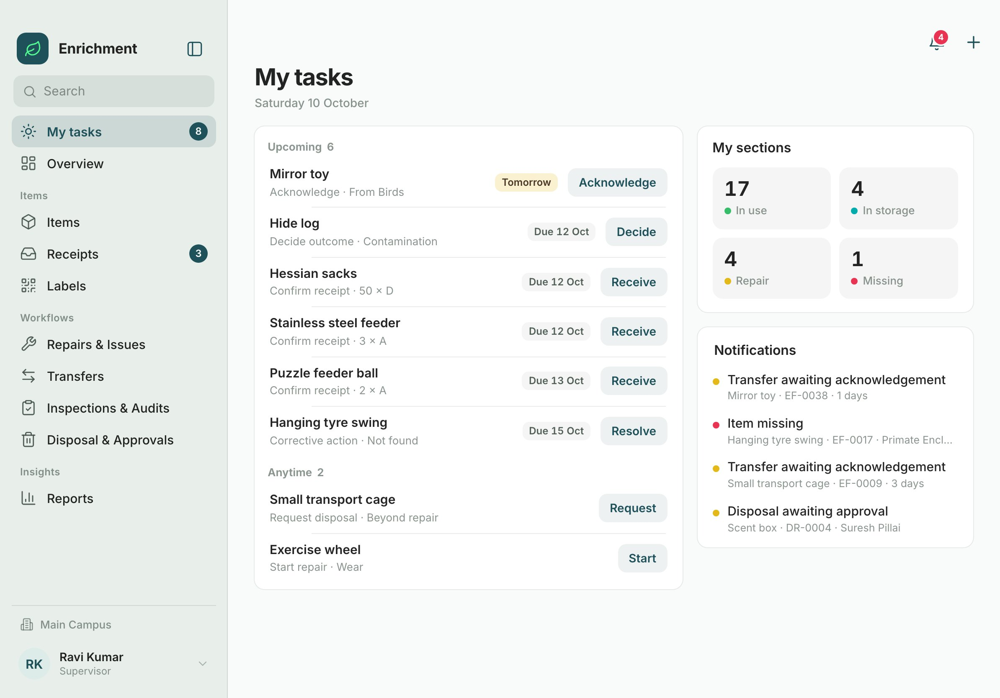
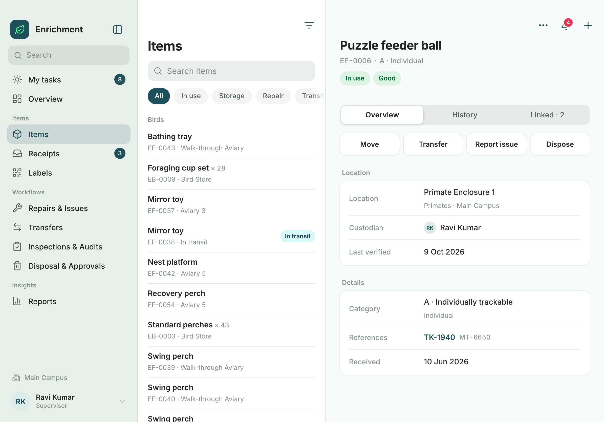
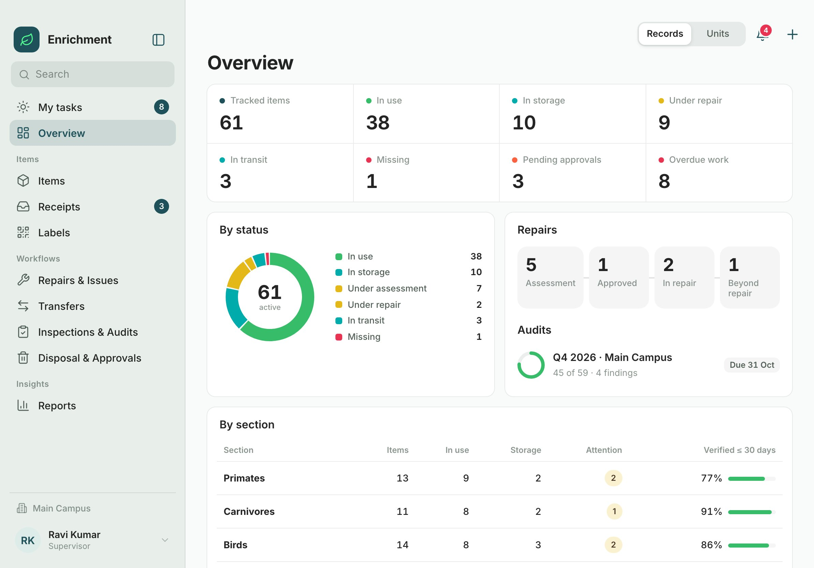
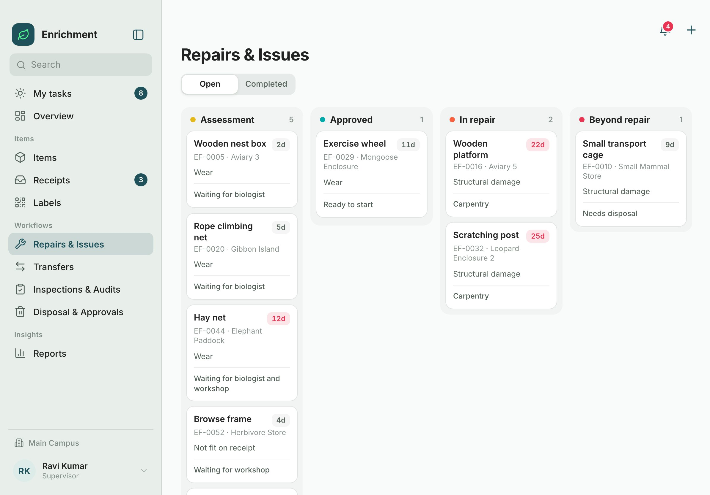
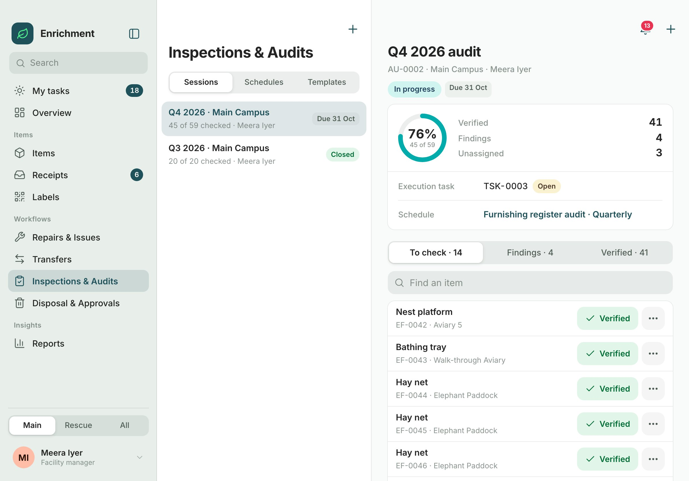
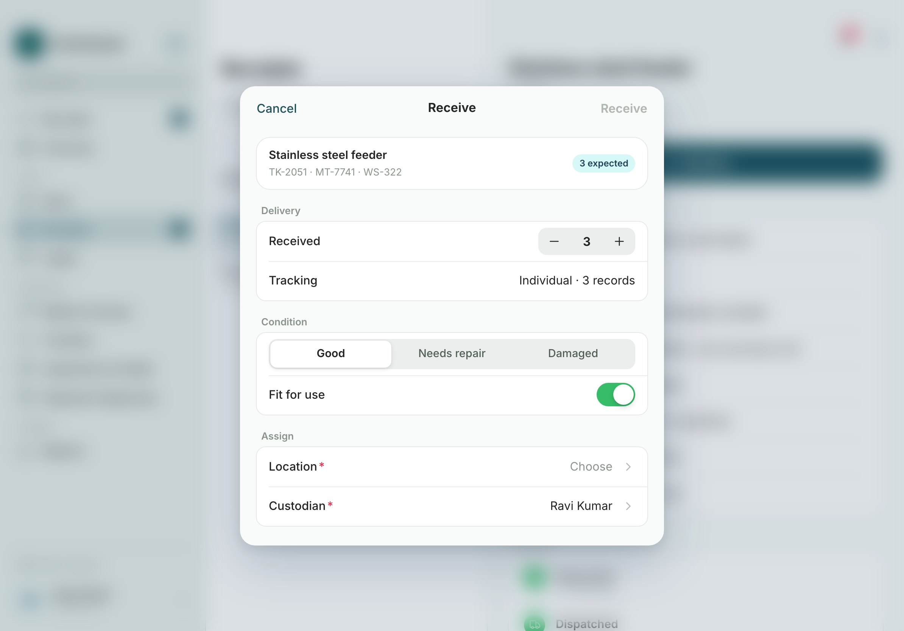
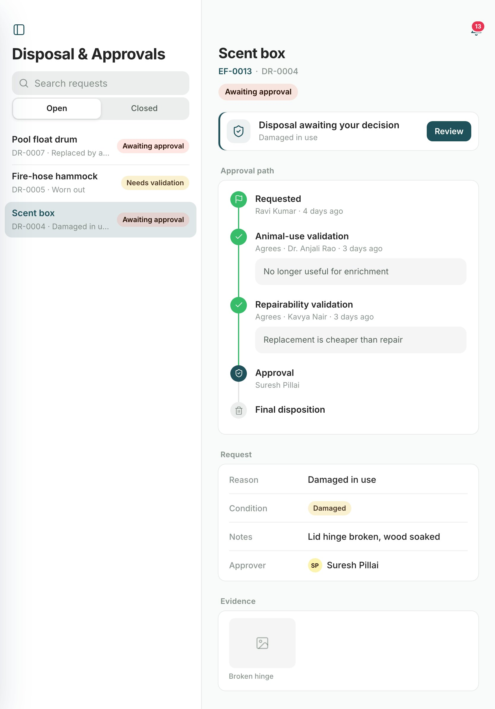

# ANTZ · Enrichment & Furnishing Management — Tablet Prototype

An interactive iPad prototype of the **ANTZ Enrichment & Furnishing Management** module (PRD v1.0, 10 Oct 2026). It covers the full lifecycle of enrichment items and furnishings in a zoo: receipt, registration, move, repair, transfer, scheduled audit, disposal, reports and labels.

**Live:** https://antz-enrichment.pages.dev

> **Prototype.** It runs on sample data in the browser. It is not connected to ANTZ: there is no backend, no real sign-in and no file storage. See [Limits](#limits).



## Run it

Needs Python 3 (for the local server) and Node 20+ (for the tests).

```sh
git clone https://github.com/naveen-lset/Enrichment.git
cd Enrichment
npm start                  # serves on http://localhost:8834
```

Open **http://localhost:8834/**.
- On a desktop the app shows inside a tablet frame. The top bar has **Landscape / Portrait**, **Demo guide** and **Reset**.
- On an iPad, or with `?bare=1`, it fills the screen and follows the device orientation.

```sh
npm test                   # 26 tests of the business rules
npm run test:ui            # UI checks at 4 iPad sizes (needs npm start and Google Chrome)
```

URL options: `?as=P-MEERA` (sign in as a person) · `?o=portrait` · `?reset=1` (fresh sample data) · `#/audits/AU-0002` (open a screen).

### Deploy (Cloudflare Pages)

```sh
npx wrangler login         # once, opens the browser
npm run deploy             # builds dist/ and publishes to antz-enrichment.pages.dev
```

## Screens

| | |
|---|---|
|  **Items** — split view: list, filters, record |  **Overview** — counts that open filtered lists |
|  **Repairs & Issues** — board by stage |  **Audit session** — one-tap verification |
|  **Receive** — form sheet with pickers |  **Disposal** — approval path, portrait |

## What it covers

| Flow | Path |
|---|---|
| **A · Receipt → registration** | Request → received quantity (shortage / excess reason) → condition → location + custodian → review → records created (individual, group, or none for excluded categories) |
| **B · Move / rotate** | Item → destination in the same section → reason → review → same record, new location, history kept; part of a group splits off |
| **C · Damage → repair** | Report issue → animal-use check (biologist) and repairability check (workshop), routed by category → start repair → complete → back in use |
| **D · Transfer** | Section + receiver + reference → review → in transit → receiver acknowledges (damage on arrival goes to assessment) · exception by facility manager |
| **E · Audit** | Template → schedule → generate occurrence (audit session + execution task) → verify / record findings → corrective-action tasks → resolve → close |
| **F · Disposal** | Reason + evidence → validations → approve / reject (item stays active) → final disposition → record kept |
| **G · Dashboard → action** | Overview count or My tasks row → the record or its action sheet → counts update |

Roles: supervisor, facility manager, biologist, workshop / VIC, approver and admin. Each sees only the sections and actions it is allowed. Use **Demo guide** to sign in as the right person for each flow.

## How the interface works

- **Navigation.** A sidebar lists the sections and has a site switch. Lists open in a split view (list on the left, record on the right), and the first record opens automatically. In portrait the sidebar slides over the content.
- **Next step.** Each record shows the one action the signed-in person can take next (Acknowledge, Check, Assess, Start repair, Validate, Review, Complete, Resolve).
- **Forms.** Every action opens as a form sheet. Pickers open as pages inside the sheet. Done stays disabled until required fields are set, and a refused rule shows at the top of the sheet. Key actions show a review page before saving.
- **Feedback.** Every change shows a toast with **Undo**. Closing an edited form asks before discarding. Overlays blur the background.
- **Touch.** Swipe a row left for quick actions, long-press for a menu, ⌘K to search. Targets are 40–52 px.

## Project structure

```
├── index.html              tablet app
├── src/
│   ├── model/
│   │   ├── model.js        business rules from the PRD (no UI) — statuses, permissions, workflows, tasks, notifications, reports
│   │   ├── seed.js         base sample history, played through the rules (used by the tests)
│   │   ├── seed-demo.js    70 sample records across 6 sections and 2 sites (app only)
│   │   └── work.js         proposed: templates, schedules, occurrences, execution and corrective tasks
│   └── ipad/
│       ├── ipad.css        design tokens, layout, components, motion
│       ├── core.js         state, router, split view, sheets, popovers, toast + undo, search
│       ├── views.js        screens
│       ├── actions.js      workflow sheets (one rule call each)
│       ├── icons.js        line icons
│       └── main.js         start-up, orientation, frame
├── kit/                    ANTZ design-kit assets (colour tokens are taken from kit/tokens.css)
├── tests/
│   ├── model.test.mjs      rule tests (npm test)
│   └── ui/                 UI checks (npm run test:ui)
├── docs/
│   ├── WORKFLOWS.md        workflow map, screens, status + role matrices, traceability, decisions, integrations, test checklist
│   ├── acceptance-criteria.md
│   └── screenshots/
├── v1.html, flow.html, src/app/   earlier phone-style build, kept for comparison
└── HANDOFF_TABLET.md       state and open points
```

## Documentation

[docs/WORKFLOWS.md](docs/WORKFLOWS.md) holds the end-to-end workflow map, the screen inventory, the tablet layout spec, the status-transition and role-permission matrices, PRD traceability, the open business decisions, the integrations needed for production, and the QA checklist. Every item is tagged **PRD**, **Proposed**, **Integration** or **Decision**.

## Design

Inter. Colours come only from the ANTZ tokens: deep teal for actions and selection, ANTZ green for success, and tones for status. Radius 12, spacing on a 4 px scale. Spring motion on sheets, panels, tabs and toasts, with reduced motion respected. No helper text in the interface.

## Limits

- Sample data only, kept in the browser's local storage (one browser, one device). **Reset** restores it.
- Not connected to ANTZ request, workshop, material-transfer, Task, Assessment or Audit modules. Those links are simulated and listed in docs/WORKFLOWS.md §9.
- Photos are placeholders. Label printing shows a preview and logs it. CSV export builds the file in the browser.
- The template / schedule / task layer (`work.js`) is a proposal for review, not an existing ANTZ capability.
