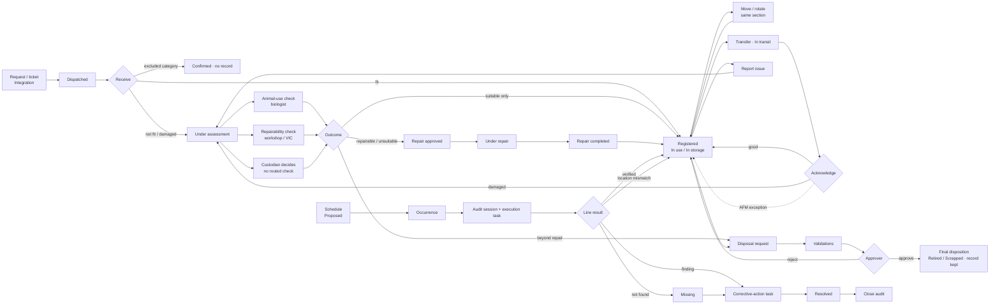

# Enrichment & Furnishing Management — workflows, screens, rules and traceability

Tablet prototype of *ANTZ_Enrichment_and_Furnishing_Management_PRD.pdf* (v1.0, 10 Oct 2026). Run it with `npm start`, then open `http://localhost:8834/`.

Every row below carries one of these tags:

| Tag | Meaning |
|---|---|
| **PRD** | Stated in the PRD. Built as a rule in `src/model/model.js`, covered by `npm test`. |
| **Proposed** | UX or behaviour proposed by this prototype. Not in the PRD. Needs sign-off. |
| **Integration** | Stands in for an existing ANTZ capability (ticket, workshop, material transfer, Task, Assessment, Audit). Must be wired to the real module. Not connected here. |
| **Decision** | Open business decision. The prototype makes a reversible choice so the flow can be shown. |

**Prototype limits.** All data is sample data, held in the browser (localStorage, one browser only). There are no APIs, no real authentication and no server confirmation. Photos are placeholders. CSV export builds the file in the browser. **Reset** (top bar, or the profile menu) restores the sample data.

---

## 1 · End-to-end workflow map

| Flow | Entry | Actions | Outcome | Next |
|---|---|---|---|---|
| **A · Receipt → registration** | My tasks › Confirm receipt · Receipts › Waiting · **+** › Receive delivery | Review the request (ticket, workshop order, material transfer) → set received quantity (+/−) → shortage / excess reason when it differs → condition + fit for use → location → custodian → **Review** → Receive | Individual: one record per unit (EF-…). Group: one record with quantity (EB-…). Excluded: delivery confirmed, no record. Not fit or not Good: Under assessment, never Available. | Opens the first new item. The request shows Received + Registered. |
| **B · Item → move** | Items › row › Move · swipe left › Move · long press › Move | Destination (same section; enclosures are disabled for items not cleared for animal use) → reason → quantity for a group → **Review** → Move | Same record, new location. Status follows the location (enclosure = In use, store = In storage). Part of a group splits into a linked record. History: Moved (from → to, reason, user, time). | Item stays open. Undo is in the toast. |
| **C · Damage → repair** | Item › Report issue · swipe › Issue | Issue type → condition → description → photo where the category needs it | Under assessment. Checks are routed by category. | Biologist: *Animal-use check* card. Workshop: *Repairability check* card. With no routed check, the custodian gets *Decide outcome*. |
| | Repairs board › card (slide-over) | Animal use: suitable / unsuitable (+ reason) · Repairability: repairable / beyond (+ assessment) | Suitable only → cleared, back to its previous status. Repairable or unsuitable → Repair approved. Beyond → disposal needed. | Start repair (team) → Complete repair (work done, team, return location, photo) → Good, back in use. |
| **D · Transfer → acknowledge** | Item › Transfer | Section (grouped by site) → receiver (custodians of that section only) → transfer reference (required for Category A) → **Review** → Dispatch | In transit. Both ends kept. | Receiver: *Arriving from …* card → condition + location → Confirm. Damaged on arrival → Under assessment. AFM / admin: Complete by exception (reason required). |
| **E · Schedule → audit → close** | Inspections & Audits › Schedules › **+** | Template → site → frequency → start → assignee | Schedule saved. Next occurrence shown. | **Generate** → one audit session + one execution task (TSK-…). Refused if the site already has an open audit or the period already exists. |
| | Session › To check | **Verified** (one tap) · **…** › Location mismatch (found at) / Condition mismatch (note) / Not found (note) / Action required (note) | Verified updates Last verified. Location mismatch corrects the register. Not found → Missing. The original line result is kept. | Findings › Assign → corrective-action task (owner, due) → owner resolves (found at, resolution) → task done → **Close audit** once every line is checked and every finding is assigned. |
| **F · Disposal → approval** | Item › Dispose · *Beyond repair* card | Reason → condition → notes / photos (by category) → approver → expedited (needs a photo) → **Review** → Submit | DR-… *Needs validation*. The item stays in the active register. | Validators agree / disagree (reason required to disagree) → approver approves or rejects (comments required) → custodian records the final disposition (**Review**) → Retired / Scrapped. The record stays searchable under *Closed*. |
| **G · Dashboard → pending action** | Overview tile · My tasks row · notification | Tile → filtered list. Task row → the record, or its action sheet through the row button. | Action completed. | Counts on My tasks, the sidebar and the Overview update straight away. |

---

## 2 · Screen and navigation inventory

Sidebar (only the sections a role may use): **My tasks · Overview · Items · Receipts · Labels · Repairs & Issues · Transfers · Inspections & Audits · Disposal & Approvals · Reports · Setup**. Footer: site switch (Main / Rescue / All for people with two sites) and the profile menu (sign in as, demo guide, reset). Toolbar on every screen: notifications, **+** (create).

| # | Screen | Route | Layout | Entry points | Roles |
|---|---|---|---|---|---|
| 1 | My tasks (pending actions + notifications) | `#/today` | full | default, sidebar | all |
| 2 | Overview dashboard | `#/overview` | full | sidebar | all |
| 3 | Item register | `#/register` | split: list | sidebar, Overview tiles, search | all |
| 4 | Item details: Overview · History · Linked work | `#/register/EF-0001` | split: detail | register row, search, any linked record | all |
| 5 | Receipts: waiting / received + request detail | `#/receipts/TK-2051` | split | sidebar, My tasks, **+** | sup, afm, admin |
| 6 | Receive sheet (location and custodian pickers, review) | sheet | form sheet | receipt detail, My tasks | sup, afm, admin |
| 7 | Register existing item | sheet | form sheet | **+** | sup, afm, admin |
| 8 | Move sheet + review | sheet | form sheet | item, swipe, long press | sup, afm, admin (own scope) |
| 9 | Repairs & Issues board (Assessment · Approved · In repair · Beyond) + Completed | `#/repairs` | full + slide-over | sidebar, Overview pipeline | all |
| 10 | Report issue · Animal-use check · Repairability check · Decide · Start / Complete repair | sheets | form sheet | item next-step card, My tasks | by role |
| 11 | Transfers: in transit / completed + route detail | `#/transfers/TR-0001` | split | sidebar, item Linked work | sup, afm, admin, mgmt |
| 12 | Transfer · Acknowledge · Complete by exception | sheets | form sheet | item, transfer detail | by role |
| 13 | Inspections & Audits: Sessions · Schedules · Templates | `#/audits/AU-0002`, `SCH-…`, `TPL-…` | split | sidebar, Overview, My tasks | sup, afm, admin, mgmt |
| 14 | Audit session workspace (ring, To check / Findings / Verified) | `#/audits/AU-0002` | split: detail | sessions list, task | auditor, afm, admin |
| 15 | Schedule audit / edit schedule · Record finding · Corrective action · Resolve · Close | sheets | form sheet | audits | by role |
| 16 | Disposal & Approvals list + approval path | `#/disposals/DR-0004` | split | sidebar, item | all |
| 17 | Request disposal · Validate · Decision · Final disposition | sheets | form sheet | item, disposal | by role |
| 18 | Notifications | popover | popover | bell, My tasks | all |
| 19 | Reports (9) with CSV export | `#/reports/status` | split | sidebar | sup, afm, admin, mgmt |
| 20 | Labels: select, preview, print | `#/labels` | split | sidebar, **+**, item › Print label | sup, afm, admin |
| 21 | Setup: categories (tracking, routing, evidence, QR) and reminders | `#/setup/CAT-A` | split | sidebar | admin |
| 22 | Search | overlay | spotlight | sidebar, ⌘K | all |
| 23 | Demo guide (8 scenarios, signs in as the right person) | sheet | form sheet | top bar, profile menu | — |
| 24 | No access | any route the role may not use | full | direct link | — |

## 3 · Tablet layout specification (Proposed)

| | Landscape 1194 × 834 (1024–1279) | Portrait 834 × 1194 (768–1023) | Desktop (≥ 1280) |
|---|---|---|---|
| Sidebar | 272 px, always shown. It can be hidden from its header. | Slides over the content from the toolbar button, with a scrim. | Shown in the tablet frame. On a touch tablet, or with `?bare=1`, the app fills the screen. |
| List + detail | List 372 px, detail fills the rest. | List 340 px, detail fills the rest. | as landscape |
| Full screens | 4-column grid | 2-column grid | 4-column grid |
| Repairs | 4 columns + slide-over detail (500 px) | Columns scroll sideways + slide-over | as landscape |
| Forms | 560 px form sheet. Pickers open as pages inside the sheet. | same | same |

Type: Inter. Page title 28/700, item title 24/700, body 15, meta 13, labels 13/600. Spacing 4 · 8 · 12 · 16 · 20 · 24 · 32. Radius 12 (sheet 20). Touch targets are 40–52 px (primary buttons 44–52). Colour: Antz tokens only (`kit/tokens.css`). Deep teal for primary actions and selection, Antz green for success, tones for status. Motion: spring easing on sheets, slide-over, segmented controls and toasts. Rings fill on entry. Reduced-motion is respected.

Interaction patterns: swipe a row left (Move, Issue); long-press or right-click a row (context menu); large title that collapses into the toolbar on scroll; segmented tabs; toast with **Undo** after every change; review page before Move, Transfer, Receive, Disposal request, Final disposition and Exception; a warning before closing an edited form; the Done button disabled until required fields are filled and locked after the first tap; refused rules shown at the top of the sheet with a shake.

## 4 · Status-transition matrix (PRD §7, §8)

| From \ action | Receive | Move | Report issue | Checks / decide | Start repair | Complete repair | Transfer | Acknowledge | Request disposal | Complete disposal | Audit: not found | Resolve found |
|---|---|---|---|---|---|---|---|---|---|---|---|---|
| (ticket) | In use · In storage · Under assessment (not fit) | | | | | | | | | | | |
| Available / In use / In storage | | In use · In storage · Available (by location kind) | Under assessment | | | | In transit | | stays (request open) | Retired / Scrapped | Missing | |
| Under assessment | | ✕ | ✕ | Previous status (cleared) · stays (approved / beyond) | Under repair | | ✕ | | stays | Retired / Scrapped | Missing | |
| Under repair | | ✕ | ✕ | | | In use · In storage (Good) | ✕ | | ✕ | | Missing | |
| In transit | | ✕ | ✕ | | | | ✕ | In use · In storage, or Under assessment if damaged | ✕ | | — not on audit | |
| Missing | | ✕ | ✕ | | | | ✕ | | stays | Retired / Scrapped | | In use · In storage |
| Retired / Scrapped | ✕ | ✕ | ✕ | ✕ | ✕ | ✕ | ✕ | ✕ | ✕ | ✕ | ✕ | ✕ |

Always refused: delete (any tracked item), Move into an enclosure for an item not cleared for animal use, Move to another section (use Transfer), a second open disposal request, Approve before required validations (except expedited), Complete before approval.

Disposal request: *Needs validation* → *Awaiting approval* → *Approved* → *Completed*, or → *Rejected* (item stays active). Repair record: assessment → approved → repair → done / cleared / beyond / closed. Audit: scheduled → open → closed.

## 5 · Role and permission matrix (PRD §11, `CAN` in model.js)

| Action | Supervisor (own sections) | Facility manager (own sites) | Biologist | Workshop / VIC | Approver | Admin |
|---|---|---|---|---|---|---|
| Receive, register | ✓ | ✓ | | | | ✓ |
| Move | ✓ | ✓ | | | | ✓ |
| Report issue | ✓ | ✓ | ✓ (any) | ✓ (any) | | ✓ |
| Animal-use check | | | ✓ | | | |
| Repairability check | | | | ✓ | | |
| Decide outcome (no routed check) | ✓ | ✓ | | | | ✓ |
| Start / complete repair | ✓ | ✓ | | ✓ | | ✓ |
| Transfer | ✓ | ✓ | | | | ✓ |
| Acknowledge | receiver only | receiving site | | | | |
| Complete transfer by exception | | ✓ | | | | ✓ |
| Request disposal · complete disposition | ✓ | ✓ | | | | ✓ |
| Validate disposal | | | ✓ (animal use) | ✓ (repairability) | | |
| Approve / reject disposal | | ✓ | | | ✓ | |
| Schedule audit · generate occurrence (Proposed) | | ✓ | | | | ✓ |
| Record audit line | ✓ | ✓ | | | | ✓ |
| Assign finding · close audit | | ✓ | | | | ✓ |
| Resolve finding | assigned owner | ✓ | | | | ✓ |
| Print labels | ✓ | ✓ | | | | ✓ |
| Configure categories | | | | | | ✓ |
| Delete a tracked item | ✕ | ✕ | ✕ | ✕ | ✕ | ✕ |

Sidebar visibility (Proposed): Receipts and Labels for supervisor, facility manager and admin; Transfers, Audits and Reports for supervisor, facility manager, admin and approver; Setup for admin only. A direct link to a hidden section shows **No access**.

## 6 · Template, schedule, occurrence, session and task (Proposed — `src/model/work.js`)

| Concept | Record | Created by | Holds | Example |
|---|---|---|---|---|
| Template | `TPL-…` | admin (seeded) | what is checked; kind = Audit / Assessment / Checklist | TPL-01 Furnishing register audit |
| Schedule | `SCH-…` | facility manager / admin | template, site, scope, frequency, start, assignee | SCH-0001 Main Campus, quarterly |
| Occurrence | inside the schedule | **Generate** | period, due date, links to session and task | Q4 2026 → AU-0002 + TSK-0003 |
| Audit session | `AU-…` (model.js) | the occurrence | expected values and the line results | AU-0002 |
| Execution task | `TSK-…` kind *audit* | the occurrence | assignee, due, open / done | TSK-0003, done when the audit closes |
| Assessment record | on the repair record | a routed check | result, by, time, note | Animal-use: Suitable, Dr. Anjali Rao |
| Corrective-action task | `TSK-…` kind *corrective* | assigning a finding | owner, due, open / done | TSK-0004, Not found · Hanging tyre swing |

Rules: one session and one task per occurrence (a repeated period, or a second open audit for a site, is refused). Editing a schedule changes only future occurrences; sessions keep their own auditor and due date. Completing a corrective task never changes the original line result. Item › Linked work shows tasks, assessments, repairs, transfers, audits and disposals for that item. **Integration**: the real Task, Assessment and Audit modules must provide these links; this prototype does not assume they do.

## 7 · PRD traceability checklist

| PRD reference | Requirement (short) | Where | Tag | Status |
|---|---|---|---|---|
| §4, FR-01 | Categories and tracking mode (individual / group / excluded), routing, evidence | Setup › category | PRD | ✓ |
| FR-02, FR-03, §5.1, AC-2 | Receipt linked to ticket, workshop order, material transfer; registration with site, location, custodian | Receipts, Receive sheet | PRD + Integration | ✓ |
| §5.1 | Partial / excess quantity needs a reason; not fit → Under assessment | Receive sheet | PRD | ✓ |
| §5.1 | Excluded category creates no record | Receive sheet (`receiveExcluded`) | Proposed | ✓ |
| FR-04 | Record receipt, status, condition, movements, transfers, repairs, retirement and disposal with timestamps and users | Item › History (every action logs actor and time) | PRD | ✓ |
| FR-05, §5.2, AC-3 | Move / rotate the same record; history; group split | Move sheet, History | PRD | ✓ |
| FR-06, §9, AC-1 | Register with search, filters, status | Items | PRD | ✓ |
| FR-07, AC-7 | No delete of tracked items | no delete anywhere; disposal only | PRD | ✓ |
| FR-08, §5.5, AC-6 | Disposal: reason, evidence, validations, approval, disposition; rejection keeps item active | Disposal & Approvals | PRD | ✓ |
| §14 | Expedited disposal with photo | Request disposal › Expedited | PRD / Decision | ✓ |
| FR-09, FR-10, §5.3, AC-5, AC-9 | Issue → routed checks → repair → completion | Report issue, checks, Repairs board | PRD | ✓ |
| FR-11, §5.4, AC-4 | Transfer, In transit, acknowledgement, exception | Transfers, Acknowledge | PRD | ✓ |
| FR-12, §5.6, AC-8 | Audit outcomes, exceptions with owner + due, close rules | Audit session | PRD | ✓ |
| — | Scheduled audits, occurrences, execution and corrective tasks | Schedules, Templates, tasks | Proposed + Integration | ✓ |
| FR-13, §10, AC-10 | Reports by site / status, disposal register, compliance, accuracy | Reports (9) | PRD | ✓ |
| FR-14 | QR labels for labelled categories, logged | Labels | PRD | ✓ (no real printer) |
| FR-15 | Timeline: actor, time, action, from → to | Item › History | PRD | ✓ |
| §3 | Pending work per role | My tasks | PRD | ✓ |
| §10 | Notifications: receipt, transfer, assessment / repair overdue, disposal, missing, audit due, exception overdue | Bell, My tasks | PRD | ✓ |
| §11 | Role permissions and scope | everywhere; No access | PRD | ✓ |
| §9 | Dashboard counts, clickable | Overview (records / units switch) | PRD + Proposed | ✓ |

## 8 · Unresolved business decisions

| # | Decision | Prototype choice | Where to change |
|---|---|---|---|
| 1 | Who approves disposal | Management approver or facility manager of the site | `CAN.approve` |
| 2 | Category routing to biologist / workshop | A always + workshop; B biologist only while in use + workshop; C none (custodian decides) | Setup |
| 3 | Evidence per category | A: photo on repair, ref on transfer, photo + notes on disposal; B: photos | Setup |
| 4 | Partial receipt | Allowed with a reason. The ticket closes; the rest is not tracked as a back-order. | `receive()` |
| 5 | Excluded deliveries | Confirmed without a record | `receiveExcluded()` |
| 6 | Audit cadence and scope | Main Campus quarterly, Rescue Centre half-yearly; scope = all active items at the site | Schedules |
| 7 | One open audit per site | Enforced | `createAudit()` |
| 8 | Can an audit close with open (assigned) findings? | Yes, when every finding is assigned | `closeAudit()` |
| 9 | Reminder days | Receipt 3, assessment 5, repair 14, approval 5 | Setup › Reminders |
| 10 | Transfer acknowledgement window | 2 days, then overdue | `tasks()` |
| 11 | Expedited disposal | Approver may approve before validation; completion still waits | `approveDisposal()` |
| 12 | Count semantics (records vs units) | Records by default; Units switch on Overview | Overview |
| 13 | Missing item path | Missing → corrective task → found (back to a location) or disposal; never auto-disposed | audits |
| 14 | QR labels phase | Phase 4, required for A, optional for B | Setup |

## 9 · Backend integrations needed for production

| Integration | Purpose | Prototype stand-in |
|---|---|---|
| Request / ticket and procurement | Source of expected deliveries (item, category, quantity, section) | `D.tickets` in the seed |
| Workshop orders | Workshop reference on receipt, repair teams | text reference |
| Material transfer | Transfer reference and dispatch status | text reference |
| Site / section / enclosure master | Locations and kinds (enclosure, store) | `D.sections`, `D.locations` |
| Users, roles, scopes, auth | Permissions, sign-in | demo people + Sign in as |
| Task module | Execution and corrective tasks, assignment, due dates, reminders | `work.js` tasks |
| Assessment module | Animal-use and repairability records | fields on the repair record |
| Audit module / scheduler | Templates, schedules, occurrences, sessions | `work.js` + `createAudit()` |
| Notifications service | Push / email of the §10 events | computed in the app |
| File storage | Photos and evidence | placeholders |
| Label printing | QR / barcode labels | preview + log only |
| Reporting and export | Scheduled reports, server exports | in-browser CSV |
| Persistence and audit log | Server-confirmed writes, history | localStorage |

## 10 · Test checklist

Use **Demo guide** (top bar) to sign in as the right person. Use **Reset** between runs.

| # | Scenario | Expected |
|---|---|---|
| 1 | Ravi › Receipts › TK-2051 › Receive with 3 | 3 records EF-…, In use, Ravi custodian; request shows Received + Registered |
| 2 | Same with 2 | Receive stays disabled until a shortage reason is written |
| 3 | Receive TK-2062 (Category D) | Confirmed, no record |
| 4 | Receive with Damaged | Records go to Under assessment, never In use |
| 5 | Receive the same ticket again | The ticket is no longer waiting; the model refuses a second receipt |
| 6 | Move EF-0006 to Primate Enclosure 2 | Review shows from / to; history adds Moved; Undo restores |
| 7 | Move part of Bamboo foraging tube (group) | New EB-… record with the moved quantity; the rest stays |
| 8 | Ravi reports an issue on EF-0006 (A) without a photo | Submit refused: "Add a photo of the issue." |
| 9 | Anjali › animal-use check › Unsuitable without a note | Save disabled; with a note → condition Unsafe |
| 10 | Joseph › repairability › Repairable › Start › Complete | Back in use, Good; repair in Linked work |
| 11 | Ravi › Hide log › Decide outcome | Custodian decides (no routed check for C) |
| 12 | Ravi transfers EF-0001 to Carnivores | Next stays disabled until the transfer reference is entered (Category A); then In transit |
| 13 | Lakshmi acknowledges with Damaged | Received, then Under assessment |
| 14 | Meera › exception on Small transport cage | Completed by exception with a reason |
| 15 | Meera › Q4 audit › Verified / Not found / Assign / Close | Line result kept; corrective TSK-… created; Close audit appears only when every line is checked and every finding assigned |
| 16 | Meera › Schedules › Rescue › Generate | Refused: open audit at the site |
| 17 | Suresh › DR-0004 › Reject without comments | Save disabled; with comments → item stays active |
| 18 | Suresh approves DR-0004 › Ravi completes Scrapped | Item Scrapped, record under Items › Closed |
| 19 | Joseph opens `#/setup` | No access |
| 20 | Rotate to portrait | Sidebar becomes a slide-over; split view stays; forms unchanged |
| 21 | Close an edited form | Discard changes / Keep editing |
| 22 | Overview › tile | Items list opens with the matching filter |
| 23 | ⌘K › "hammock" | Items, deliveries and disposals that match |

## 11 · Enrichment activities (Proposed — `src/model/activity.js`, screens in `src/ipad/activity-views.js`)

Source: Figma file `5iizWNcFdePpGJpenKpaTG` ("Enrichment Module Mobile App"), flows `44:374` and `553:801`. These flows are **not in PRD v1.0**; the whole section is **Proposed** and needs scope sign-off. Drawn in the ANTZ app style (diet-request app): session cards like diet request cards, Species like Diet by Species.

**Names (to avoid the two clashes with the PRD):** *Activity type* (social, cognitive, environmental, food-based, sensory), never "category" (the PRD's A–D tracking category). *Observation* (how the animal responded), never "assessment" (the PRD's item condition check).

| Step | Who | Screen | Rule |
|---|---|---|---|
| Create activity | keeper, supervisor, biologist, AFM, admin | + › New activity | Name, type, goal and at least one species; a duplicate name is refused. Starts **Awaiting approval**. |
| Approve | biologist only | Activities › Awaiting approval, My tasks | Approve, or send back with a note (**Changes requested**); the author edits and resubmits. |
| Assign | supervisor (own sections), AFM (own sites), admin | Species › Recommended, + › Assign activity | Only an approved activity, for a species it is approved for, in an enclosure where the animals live, to a keeper of that section; species-wide or one animal; daily / alternate days / weekly / once, morning / midday / afternoon. |
| Inventory check | — | session cards, Assign sheet, Species | Reads the item register for each material at the enclosure: **ready** (usable item there), **in store** (usable in a store of the section), **blocked** (under assessment / repair / unsafe), **not in the register**. Uses `usableForAnimals()` from model.js. |
| Run and record | the assigned keeper (and supervisor / AFM / admin) | Sessions › Record, My tasks | One record per plan and day, not before the day. Materials used must be cleared items at that enclosure; each gets a *Used in activity* event in its history. Engagement, behaviours, successful (yes / partly / no), 1–5 rating, comments, photos. Or **Skip** with a reason. |
| Safety incident | keeper | Record session › Safety | The item must be one used in the session. It is flagged **Unsafe** through `flagIssue()`, so it goes into the PRD repair flow (biologist / workshop checks) and leaves animal use. |
| Material request | keeper, supervisor | + › Request material, session detail | Goes to the section custodian. |
| Inventory approval | custodian (supervisor), AFM, admin — **not the biologist** | Material requests | **Issue** a usable stored item (moves it to the enclosure through `move()`, splitting a batch) — or **Send to the request module** (needs a reason when a usable item is in store) — or **Decline** with a reason. The request module itself is **Integration**: delivery then arrives in Receipts as today. |
| Results | everyone | Activity › Results, Species, Reports | Sessions, % successful (partly = half), average rating, safety incidents, behaviours seen; *Activity effectiveness* and *Unused activities* (approved, not assigned or no session in 30 days) reports. |

New role **Keeper** (`ROLE.keeper`): acts in own sections like a supervisor; can report an item issue; cannot move, transfer, receive or dispose. Disposal & Approvals is hidden for keepers.

Prototype limits: no live timer (duration is picked); voice notes, video and the idea gallery from Figma are not built; animals and species are sample data and must come from the ANTZ animal module (**Integration**). The Figma screens are a phone app; this prototype draws them for the iPad.

Open decisions: who may create activities (all staff, or supervisors and biologists only); whether a keeper can record a colleague's session; whether "partly" counts as half a success; the 30-day window for *unused*.

## 12 · Enrichments, Phase 1 (rules `src/model/products.js` · components `src/ipad/enrichment-components.js` · screens `src/ipad/enrichment-views.js`)

Built from the *ANTZ Enrichments — Phase 1 Implementation Brief*. Sidebar › **Enrichments**, scoped by the site menu in the header. One module tab bar: **Products · My requests · Approvals** (each shown only to the roles that can use it).

**Data sources (no second inventory).** A *product* is a record of the item register (`D.items`, model.js): status, custodian, location, condition and history come from there. The **five enrichment types** are the existing activity types `ACT_TYPE` (Social, Cognitive, Environmental, Food-based, Sensory, activity.js). Associations: the enclosure a product is in, the animals living there and their species (activity.js sample animals). Activities and sessions: the activities that list the product as a material and the sessions that used it.

| Screen | What it shows | Who |
|---|---|---|
| Products | Five type tabs (+ All), search (name, ID, species, animal, custodian, type), filter sheet (status, custodian, species, animal, enclosure) with removable tokens and Clear, cards by default, list layout switch (remembered per browser). | everyone |
| Product detail (slide-over) | Image, name, type, status · actions · location, custodian (Change), tracking, condition · associations · enrichment activities (opens the activity) · recent sessions · requests · history (last 6, link to the full item history). | everyone |
| My requests | Own requests by status: All, Draft, Pending, Approved, Rejected, Completed. Detail: progress (every logged step once, then what it waits for), request fields, associations, photos. Edit / Withdraw (pending), Submit / Edit / Delete (draft), Revise (rejected). | biologist |
| Approvals | Requests routed to the person: Pending approval / Decided, request-type chips, search (ID, product, biologist, site). Approve / Reject. | supervisor, site manager (AFM), admin |

### Requests

| Type | Form | On approval |
|---|---|---|
| Product request | product (eligible products of the user's sites), quantity (group records), reason*, notes, custodian (default: requester), optional species / animals / enclosure | **Approved**. Fulfilment rule not defined → stays Approved (D-E1). |
| New product | name*, enrichment type*, description*, details, justification*, site (when the user has several and no enclosure is picked), custodian, optional associations, supporting photos | **Approved**. No product is created in the listing (D-E2). A name already in the listing is refused. |
| Movement (same site) | destination* (same section, not the current location; enclosures disabled when the item is not cleared for animal use), quantity (group), reason*, notes, associations | `move()` runs as the approver → item moved (a group splits) → request **Completed**. |
| Transfer (inter-site) | destination site* (another site), section*, location, receiving custodian* (custodians of that section), material-transfer reference (required when the category requires it), reason*, notes | **Approved** only. Phase 2: dispatch, then receipt completes it (§13). |
| Custodian change | new custodian* (biologist, supervisor or site manager of the product's site), note | No approval. Item history *Custodian changed*; notification to the new and the previous custodian. |

Every request is checked by the model when it is submitted: movement and transfer are tried on a copy of the data with the PRD rules of `move()` / `transfer()`, so a request that the approver could not carry out is refused at once with the rule's message.

### Status transitions (agreed model, no extra status)

| From | Event | To | Who |
|---|---|---|---|
| — | Save as draft | Draft | requester |
| — | Submit | Pending approval | requester |
| Draft | Submit (full check) | Pending approval | requester |
| Draft | Delete | (removed) | requester |
| Pending approval | Edit | Pending approval | requester |
| Pending approval | Withdraw | Draft | requester |
| Pending approval | Approve (product request, new product) | Approved | reviewer |
| Pending approval | Approve (movement) | Approved → Completed in the same step | reviewer |
| Pending approval | Approve (transfer) | Approved (awaiting dispatch) | reviewer |
| Approved (transfer) | Dispatch | Approved (in transit) | sending supervisor or site manager |
| Approved (transfer) | Receipt acknowledged, or completed by exception | Completed | receiving custodian · site manager |
| Pending approval | Reject (comment required) | Rejected | reviewer |
| Rejected | Revise | new Draft (the rejected request is kept) | requester |

### Roles (`CAN.prodRequest`, `CAN.prodReview`, `CAN.prodCustodian`)

| | Biologist | Supervisor | Site manager (AFM) | Admin |
|---|---|---|---|---|
| Browse products | ✓ | ✓ | ✓ | ✓ |
| Create, edit, withdraw own requests | ✓ | — | — | — |
| Review | — | own sections | own sites | all |
| Approve own request | never (refused by the model) | | | |
| Change custodian | sites | own sections | own sites | all |
| Move / transfer from the product | by request | directly (existing Move / Transfer sheets) | directly | directly |

Routing: a request goes to the supervisors of the product's section (or of the picked enclosure's section for a new product) **or** to the site manager of the site; one approval decides. A new product without an enclosure has no section and goes to the site manager.

### Notifications (existing in-app list: bell, My tasks)
`notifications()` of model.js is extended, not replaced: **Request awaiting approval** (to the reviewers, while pending), **Request approved / rejected (with the comment) / Movement or Transfer completed** (to the requester), **Custodian changed** (to the new and the previous custodian). Reviewers also get a *Review request* row in My tasks. No email.

### Dependencies and conflicts to confirm

| # | Item | Prototype choice |
|---|---|---|
| D-E1 | Completion rule for a product request (issue from store? hand-over? custodian change?) | Stays **Approved**; nothing changes on the item. |
| D-E2 | Does an approved proposal create a live product? | No. It needs the procurement / receipt flow (Receipts) to create the record. |
| D-E3 | **Resolved in Phase 2 (owner's choice, 12 Oct):** Phase 1 completed a transfer on approval; PRD FR-11 and the Phase 2 brief require receipt. | Approval, dispatch and receipt are separate; the request is Completed only on receipt (§13). |
| D-E4 | **Conflict:** brief says biologist is the default custodian and can reassign; PRD makes the section supervisor the custodian (`custodiansOf`, receive / transfer rules). | Custodian change allows biologist, supervisor or site manager of the site. The request's custodian defaults to the requester. Other PRD flows still pick custodians from supervisors / AFM. |
| D-E5 | "Same-site movement" across sections | PRD `move()` allows only the same section (another section is a transfer). The destination list shows the product's section only; a cross-section move inside one site has no request type in Phase 1. |
| D-E6 | Enrichment type of a product | The register has no type field. A product takes the type of the activities that use it; `SAMPLE_TYPES` fills the rest for the demo. Equipment with no type (cages, crates) is not listed. A real product-type attribute is needed. |
| D-E7 | Product photos and descriptions | The register has no photo or description per product; the card shows a placeholder image and the category tracking. |
| D-E8 | "Site manager" role | Mapped to the existing site-scoped AFM role; no new persona. |
| D-E9 | Type-specific activity fields | Only fields that exist are shown (sub-type, duration, additives for food-based). The five types have no further defined fields. |
| D-E10 | Request numbering, server checks, audit log | `ER-0001…` from the local sequence; every rule is in `products.js` and must be enforced by the backend API (hiding a button is not access control). |

**Integration** for production: request API (create, update, withdraw, approve, reject) with server-side permission and routing; notification service; product-type and photo attributes on the item master; animal / species master. None of these exist in the prototype; everything runs on sample data in the browser.

**Tests:** `tests/products.test.mjs` (12): types, associations, who requests, routing and self-approval, rejection comment, movement through `move()`, transfer through `transfer()` with acknowledgement still pending, edit / withdraw / draft, proposal rules, custodian change, tasks and notifications, revise. UI checks cover the Enrichments screens and sheets at 6 sizes (biologist, AFM, supervisor, admin).

## 13 · Enrichments, Phase 2 — lifecycle controls

Built from the *Phase 2 Implementation* brief, on the existing PRD rules of `model.js` (they are unchanged) and the Phase 1 module. Rules: `src/model/products.js` · parts: `src/ipad/enrichment-components.js` · screens: `src/ipad/enrichment-views.js` · two existing sheets in `src/ipad/actions.js` take an optional mode.

**Owner decisions (12 Oct):** (1) transfers: approval, dispatch and receipt are separate steps; (2) the workshop repairability check of categories A and B stays a PRD rule and shows in Enrichments as a waiting step with no workshop actions.

| Phase 2 step | Where | What runs underneath (existing unless marked new) |
|---|---|---|
| Movement and rotation | Product detail › Move; biologist through a movement request | `move()`: same record, same section, history *Moved* with from / to / reason / actor / time; a part of a group splits into its own record (PRD rule). Supervisor / site manager move directly (no approval in the configured rules); biologist needs a request (Phase 1). |
| Storage and retrieval | Product detail › Location › **Store** / **Return to use** | `move()` to a store (status In storage) or to an enclosure / other place (In use); the destination list shows only that kind. Biologist: the same movement request with those destinations. Timeline: *Moved to storage* / *Returned to use* (the status change move() writes). |
| Condition issue | Product detail › Condition and repair › **Report issue** | `flagIssue()`: issue type, condition from the existing list (Needs repair, Damaged, Unsafe), description, photos (category rules), reporter and time. Item goes Under assessment; a second report while one is open is refused. |
| Repair | Condition and repair (steps with the action of the person signed in) | Routed checks from the category: animal-use check (biologist, `verifyAnimalUse()`), repairability check (PRD workshop / VIC role: waiting step only), or custodian decision (`decide()`); then `startRepair()` and `completeRepair()` (work done, team, return location, photos) by the supervisor / site manager. Earlier issues stay in *Earlier issues* (`item.repairs`). Beyond repair stops here (disposal is Phase 3). |
| Transfer | Product detail › Transfer stages; Approvals › **To dispatch**; My tasks | **New:** `approveRequest()` no longer dispatches; `dispatchTransfer()` (date, reference, note) calls `transfer()` as the sender; `acknowledge()` / `completeWithoutAck()` of model.js are wrapped so that any receipt (Enrichments or the Transfers screen) completes the request. The item keeps its ID; site, location and custodian change only at receipt. |
| Lifecycle timeline | Product detail › Lifecycle | **New** `lifecycleEvents()`: every item history entry plus the request log entries (submitted, approved, rejected, withdrawn), typed Movement · Storage · Condition · Repair · Transfer · Custodian · Request · Other, newest first, filter chips, 10 then *Show all*. Nothing is added that is not stored. |

**Transfer stages** (one request, no extra status): Requested (*Pending approval*) → Approved (*Approved · Awaiting dispatch*) → In transit (*Approved · In transit*) → Received (*Completed*). The stage bar shows done (green), current (navy), next (navy outline) and to come (grey); the current stage carries its one action (Review, Dispatch or Acknowledge receipt) for the person allowed to take it.

**Duplicate submissions:** the Done button disables on tap (existing); the rules also refuse a second open movement / transfer request for a product, a second pending product request by the same person, a second approval or rejection, a second dispatch, a second receipt, a second issue while one is open, and starting a repair twice.

**Notifications (existing list):** *Transfer awaiting dispatch* (senders), *Transfer dispatched* and *Transfer received* / *completed by exception* (requester), *Transfer awaiting acknowledgement* (receiver, existing PRD notification).

### Phase 2 dependencies and open decisions

| # | Item | Prototype choice |
|---|---|---|
| D-P1 | Repairability check for categories A and B needs the PRD workshop / VIC role. | **Decided 12 Oct: no repairability check** (§14). |
| D-P2 | Partial group moves create a new record for the part moved (PRD rule), which reads as a "new product". | Kept; the new record links to its parent (*Split from batch*). |
| D-P3 | Cancel or reject an approved transfer before dispatch | Not supported; no rule exists. |
| D-P4 | Cross-section move inside one site | PRD treats it as a transfer; the Phase 2 transfer request is inter-site only (D-E5). |
| D-P5 | A condition assessment with no issue (item checked and fine) | No rule records it outside an audit (Phase 3); only issues are recorded. |
| D-P6 | Backend | Every rule above runs in the browser on sample data; the API must enforce the same permissions and states (`dispatchTransfer`, receipt hook, duplicate checks). |

**Tests:** `tests/lifecycle.test.mjs` (9): rotation, storage and retrieval, condition issue, repair with routed checks, repair with custodian decision, receipt through the Transfers screen and by exception, permissions, duplicate refusals, timeline accuracy. `tests/products.test.mjs` updated for the three-step transfer and duplicate rules. UI checks include the new sheets.

## 14 · Minimal navigation and roles (owner's decision, 12 Oct)

The owner asked for a simpler product: fewer screens, fewer roles, a bottom navigation.

| Before | Now |
|---|---|
| Left sidebar with 12 entries (My tasks, Overview, Enrichments, Enrichment activities, Items, Receipts, Labels, Repairs, Transfers, Audits, Disposal, Reports) | **Bottom tab bar: Home · Enrichments · Requests** (GRC kit C-01 measures: 72 px, 12 px labels, 2 px Primary mark, badge on Home). |
| 7 roles in *Viewing as* (keeper, supervisor, facility manager, biologist, workshop, approver, admin) | **Biologist · Supervisor · Site manager** only (the site-scoped AFM role is labelled *Site manager*). |
| My tasks merged every module's work | **Home**: To do for this person in the Enrichments flow only, and Updates (anything already in To do is left out). Biologist: animal-use checks, drafts, rejected requests. Supervisor / site manager: reviews, dispatches, receipts, repair decision / start / complete. |
| Module tab bar Products · My requests · Approvals | **Requests** tab opens the biologist's requests, or the approvals of a supervisor or site manager. |
| Repairability check by the workshop role | **Removed.** After the biologist's animal-use check (when the category asks for one) the custodian decides: repair, clear or beyond repair. An item unsuitable for animals still goes to repair. `D.config.techCheck = false`, applied after the sample history (`noRepairCheck()` in products.js); open repairs that were waiting for the check go to the custodian. |

Not in the navigation any more (code kept, reachable by URL only): Overview, the activity module (sessions, activities, species, material requests), Items, Receipts, Labels, Repairs board, Transfers, Audits, Disposal, Reports, Setup, and the + menu. Repairs and transfers are handled inside the product. Notifications show only this flow (biologist: request updates; supervisor / site manager: also transfers and repairs).

Open: receipts (how new products enter the register) and disposal / audit (Phase 3) have no entry point in this navigation.

## 15 · Design: the Antz tablet components (Components.md, 12 Oct)

The owner supplied `Components.md` (the Antz procurement tablet kit). The app now uses it as its component library, rewritten for this plain-JS app in `src/ipad/antz-kit.js` (functions that return HTML) and `src/ipad/antz-kit.css` (class prefix `ak-`, Antz tokens only; the four kit colours without a token are alpha steps of existing tokens).

| Kit component | Where it is used |
|---|---|
| AppBar | Page header (title, site as the sub line) and the bar of every full-screen panel (back, ID, type) |
| CountTabs | Enrichment types on Products; request statuses on Requests |
| ListBar + SearchBox | The band under the tabs: list title, 320 px rounded search, filter button, card / list switch |
| Chips | Request types (Approvals), history types (product), active filters |
| RecordCard + bands | Product cards (status band, custodian) and request cards (yours / waiting / approved / in progress / completed / rejected) |
| Fab | New request (biologist) on Products and Requests |
| BottomNav | Home · Enrichments · Requests, pill on the active tab, red badge |
| FullPanel + StatusFoot | Product and request detail: header card, Stepper card, Cols (3 : 2) with Sections, fixed footer with the current status and the actions |
| Stepper | Transfer (Requested → Approved → In transit → Received), issue and repair, request progress, and Details → Review in forms |
| Section, KV, Timeline | Detail sections; history newest first, marked green |
| ApproverRow, EndCard, DecisionButtons, ResultBanner, ReasonDialog | Request review: Reject / Approve in the footer; Approve shows *You Approved*; Reject asks for the required reason; a rejected request ends with the end card |
| TaskTile | Home tiles by kind of work, tap to filter To do |
| Sheet, SideSheet, PickRow, Field / TextIn / Choice / Stepper2 / PickField | Every form (bottom sheet with grab handle, title, close, footer), Filters (side sheet), pickers, Viewing as (RoleSheet) |

Rules kept from the kit: no helper text in screens, one fact once (the decision reason shows in one place), one main action per footer, 44–48 px targets, tokens only, native tablet pattern (no frame).
